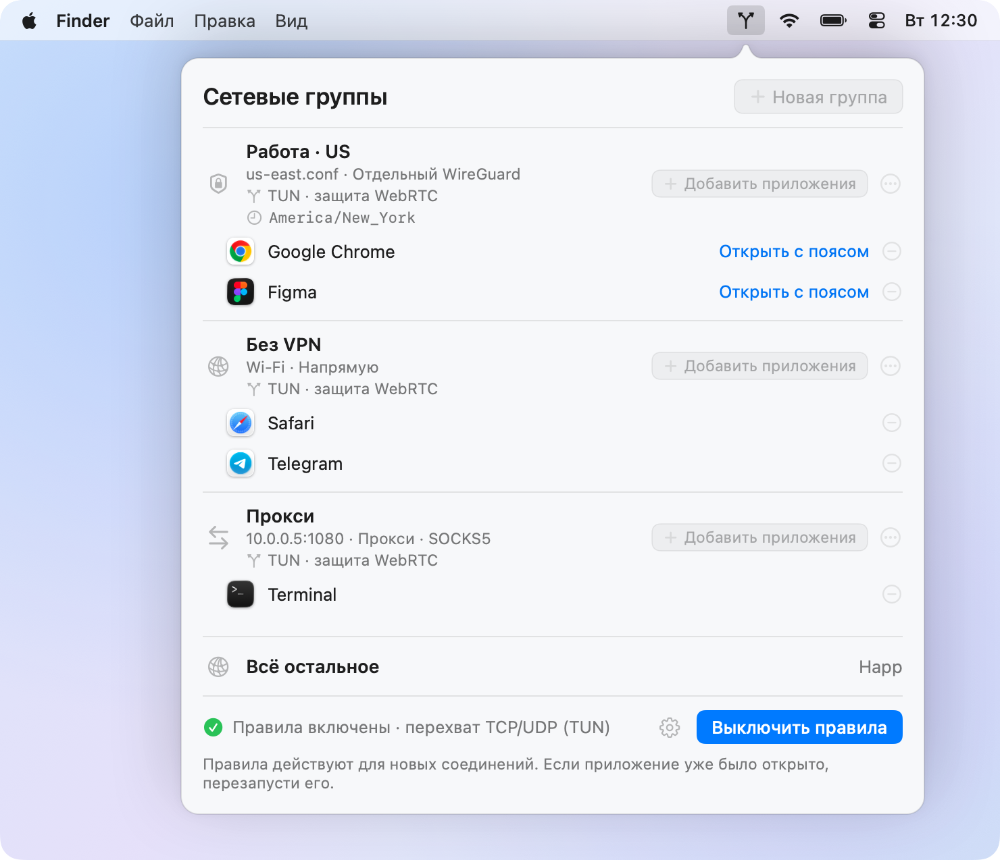

# SplitLane

Нативное приложение в строке меню macOS для раздельной маршрутизации приложений по разным сетям, VPN и прокси с изоляцией групп.

**macOS 15+** · **Apple Silicon** · **SwiftUI + модифицированный `sing-box 1.14.1`**

[Скачать последний релиз](https://github.com/oxgeneral/SplitLane/releases/latest) · [Инструкция по установке](INSTALL.txt) · [Changelog](CHANGELOG.md)

<p align="center">
  <picture>
    <source media="(prefers-color-scheme: dark)" srcset="docs/preview-dark.png">
    <source media="(prefers-color-scheme: light)" srcset="docs/preview-light.png">
    
  </picture>
</p>

---

## Какие проблемы решает

В macOS сеть настраивается **на весь компьютер сразу**, а не на отдельные приложения. На практике в одной рабочей сессии одновременно открыты сервисы с взаимоисключающими требованиями к сети — из-за этого пользователи тратят время на постоянное переключение VPN, держат костыли из вторых браузеров и виртуальных машин или рискуют утечкой реального IP.

SplitLane переводит управление сетью с уровня «весь Mac» на уровень **групп приложений с предсказуемыми правилами**:

| Проблема пользователя | Решение в SplitLane |
| --- | --- |
| **Конфликт сетей в одной сессии.** Включаете VPN для рабочих или AI-инструментов — отваливаются банки, локальные сервисы, звонки или падает скорость; выключаете — рвутся рабочие сессии. | Разводите приложения по группам один раз: нужные программы идут через VPN или прокси, локальные сервисы и браузер — напрямую через Wi-Fi/Ethernet, без постоянного переключения тумблера. |
| **Нельзя совмещать несколько выходов.** Обычные VPN-клиенты перехватывают весь трафик целиком и конфликтуют друг с другом. | Разные группы работают параллельно: например, один набор приложений через Happ или системный VPN, другой через отдельный WireGuard `.conf` или AmneziaVPN, третий через SOCKS5/HTTP-прокси. |
| **Тихие утечки и обход прокси.** Приложения с прямыми TCP/UDP-сокетами и WebRTC игнорируют системный прокси, а при обрыве VPN трафик незаметно уходит в домашнюю сеть. | Изоляция групп по принципу *fail-closed*: TUN-перехват TCP и блокировка UDP включены по умолчанию; при обрыве выхода соединения группы блокируются, а при аварии срабатывает PF kill-switch с восстановлением сети в один клик. |
| **Рассинхрон IP и часового пояса.** Региональные сервисы и QA-сценарии ломаются, когда трафик идёт из другой страны, а часы системы остаются локальными. | Назначение часового пояса отдельно на группу (включая дочерние XPC-процессы) или временное переключение пояса всего Mac с автоматическим откатом. |
| **Высокая цена ручной настройки.** Консольные конфиги `sing-box`, правила `pfctl` и таблицы маршрутизации сложны в поддержке и легко оставляют «сломанную» сеть после сбоя. | Нативный интерфейс в строке меню (drag-and-drop `.app` на группу), безопасный откат настроек при выходе и встроенная диагностика. |

**Типовые сценарии:**
- **Разработка и работа с AI-инструментами:** IDE, клиенты ИИ и зарубежные API идут через VPN, пока браузер, банки, мессенджеры и звонки работают напрямую без задержек.
- **Корпоративный и личный контур на одном Mac:** рабочий стек ходит через офисный VPN/WireGuard, личные приложения — через обычную сеть.
- **Тестирование и работа с разными регионами:** параллельные группы с разными прокси/VPN и соответствующими часовыми поясами без переключения учётных записей и виртуальных машин.

---

## Возможности

- **Группы маршрутизации** — назначьте разным приложениям свой выход:
  - **Wi-Fi / Ethernet** (прямой выход через выбранный интерфейс)
  - **VPN-клиенты** (Happ и другие приложения с VPN в macOS, включая iOS-приложения на Apple Silicon) и **системные VPN-профили**
  - **Отдельный WireGuard** по файлу `.conf` (работает параллельно с системным VPN)
  - **SOCKS5 / HTTP CONNECT / HTTPS CONNECT** (логин и пароль хранятся в Связке ключей macOS)
  - **[AmneziaVPN · отдельный выход](Integrations/Amnezia/README.md)** (совместимая сборка AmneziaWG без глобальных маршрутов)
- **Перехват и блокировка UDP** — TUN-перехват новых TCP-соединений и блокировка UDP приложений группы включены по умолчанию. Если выход группы отключён, обработанные её правилом соединения завершаются ошибкой. Когда HTTP/HTTPS-запрос поступает с именем хоста через прокси SplitLane, для VPN-групп движок использует DNS по HTTPS через выбранный туннель. Если приложение само разрешило имя через macOS, запрос может пройти через системный DNS. Перехват действует в текущей учётной записи и имеет исключения для loopback, link-local и multicast.
- **Динамическое «Всё остальное»** — автоматически определяет текущий системный выход macOS (физическая сеть, активный системный или сторонний VPN вроде Happ, AmneziaVPN, Tailscale, WireGuard, WARP и др.).
- **Часовые пояса** — запуск отдельных приложений с заданным часовым поясом (включая дочерние XPC-процессы) или временная смена пояса всего Mac с автоматическим откатом.
- **Удобное управление** — перетаскивание `.app` из Finder прямо на группу, перенос между группами, опциональное включение правил без повторного ввода пароля (через ⚙, с привязкой к SHA-256 бинарников).

---

## Установка

1. Скачайте **`SplitLane-*-mac-arm64.dmg`** (или `.zip`) со страницы [Releases](https://github.com/oxgeneral/SplitLane/releases/latest) и перенесите **SplitLane.app** в **«Программы»**.
2. Тестовая сборка подписана ad-hoc и распространяется без нотаризации Apple. Сверьте SHA-256 файла с `SHA256SUMS.txt` из релиза. Если Gatekeeper остановил первый запуск, разрешите открытие SplitLane в **Системных настройках → Конфиденциальность и безопасность → Всё равно открыть**. [Инструкция Apple](https://support.apple.com/102445)
3. Откройте **SplitLane** (значок с развилкой в строке меню), нажмите **«Создать группу»**, выберите выход, добавьте приложения и включите правила.
4. Перезапустите приложения из группы, чтобы они открыли новые соединения.

При штатном выключении правил и выходе из приложения SplitLane восстанавливает системный прокси и часовой пояс. После аварии во время перехвата SplitLane пытается перевести PF в режим блокировки. На это время могут блокироваться и новые соединения приложений вне групп в текущей учётной записи. При следующем открытии нажмите **«Восстановить сеть»** и подтвердите действие администратором. Если в macOS уже включён другой системный прокси или PAC, SplitLane остановит запуск, чтобы сохранить чужие настройки.

---

## Сборка из исходников

Требования: **macOS 15+**, **Xcode Command Line Tools**, **Go 1.25.5+**.

```sh
./build.sh local          # Сборка .build/local/SplitLane.app (основной режим)
./build.sh test           # Swift-тесты, проверка pf-правил и sudoers-политики
./build-engine.sh test    # Go-тесты модифицированного движка sing-box
```

<details>
<summary>Дополнительные режимы сборки и релиза</summary>

| Команда | Назначение |
| --- | --- |
| `./build.sh preview` | UI-предпросмотр без сетевого движка (общие сохранённые группы) |
| `./build.sh tun` | Полный TUN-режим (без системного VPN) |
| `SPLITLANE_AMNEZIA_APP=/path/to/app ./build.sh standalone` | Сборка со встроенной [совместимой AmneziaVPN](Integrations/Amnezia/README.md) |
| `./release.sh` | Тестовая ad-hoc сборка для Apple Silicon. В `.build/adhoc/` появятся ZIP, DMG и SHA-256 |
| `./release.sh notarized` | Опциональная нотаризация при наличии Developer ID |
| `./build.sh signed` | Экспериментальная сборка с Network Extension (App Proxy) |

Для тестового пакета задайте версию и номер сборки, например `SPLITLANE_RELEASE_VERSION=0.1.1 SPLITLANE_BUILD_NUMBER=2 ./release.sh`. Идентификатор по умолчанию — `io.github.oxgeneral.splitlane`. Для режима `notarized` также задайте `SPLITLANE_SIGN_IDENTITY`, `SPLITLANE_BUNDLE_ID` и `SPLITLANE_NOTARY_PROFILE`. Для локальной сборки с постоянной подписью укажите `SPLITLANE_LOCAL_SIGN_IDENTITY`, чтобы Связка ключей не запрашивала доступ после каждого обновления.

</details>

---

## Лицензия и сторонние компоненты

Приложение включает модифицированную сборку движка [sing-box 1.14.1](https://github.com/SagerNet/sing-box/tree/v1.14.1) под лицензией **GPL-3.0-or-later**. Патчи находятся в `Sources/Engine/`, скрипт сборки — в `build-engine.sh`. Пакет включает [уведомления sing-box](THIRD_PARTY_NOTICES.txt) и [полный текст GPLv3](GPL-3.0.txt).
